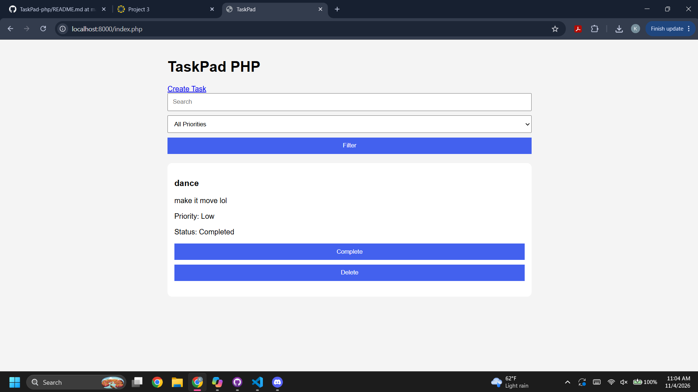
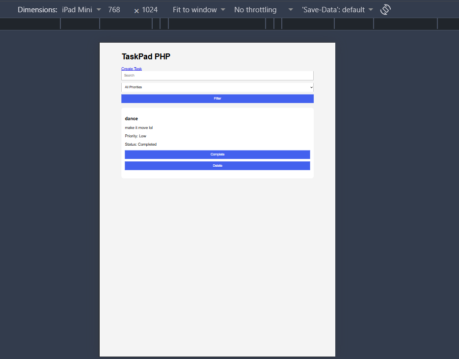
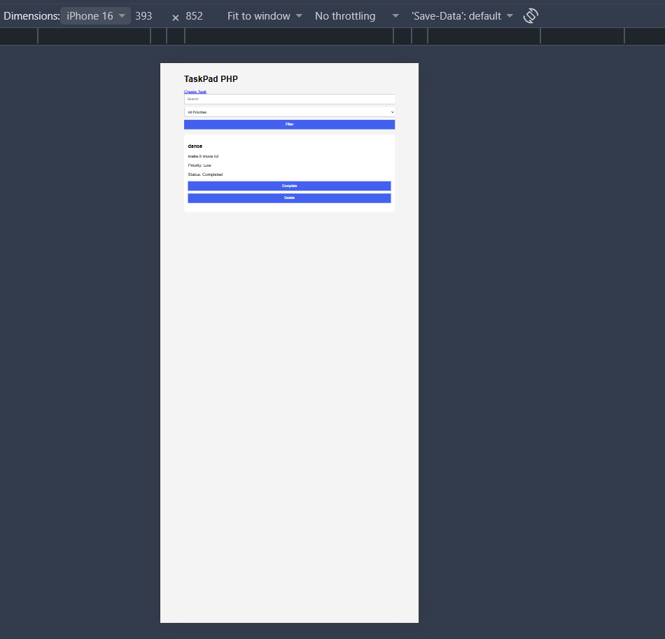

# TaskPad PHP

TaskPad PHP is a simple server-side task management application built with PHP and JSON file storage.

The application allows users to:

- Create tasks
- View all tasks
- Filter tasks by keyword and priority
- Mark tasks as completed
- Delete tasks
- Persist task data using a JSON file

---

## Technologies Used

- PHP 8.x
- HTML5
- CSS3
- JSON File Storage
- Git & GitHub

No database or framework is required.

---

## Features

### Create Task

Users can create a task with:

- Title (Required)
- Description (Optional)
- Priority
  - Low
  - Medium
  - High
- Due Date (Optional)

Server-side validation ensures:

- Title cannot be empty
- Due date follows YYYY-MM-DD format

---

### List Tasks

Display:

- Task title
- Description
- Priority
- Due date
- Status (Open / Completed)

---

### Filter Tasks

Users can search by:

- Title
- Description

Users can also filter by:

- Low Priority
- Medium Priority
- High Priority

---

### Complete Tasks

Tasks can be marked as completed.

---

### Delete Tasks

Tasks can be permanently removed.

---

### Data Persistence

Task information is saved in:

```text
/data/tasks.json
```

Data remains available even after the application is restarted.

---

## Project Structure

```text
taskpad-php
│
├── public
│   ├── index.php
│   ├── create.php
│   ├── actions.php
│   │
│   └── assets
│       └── style.css
│
├── src
│   ├── storage.php
│   └── validation.php
│
├── data
│   └── tasks.json
│
├── docs
│   ├── uml-usecase.pdf
│   ├── uml-class.pdf
│   ├── uml-activity.pdf
│   └── screenshots
│
└── README.md
```

---

## UML Diagrams

Located in:

```text
/docs
```

### Included Diagrams

- Use Case Diagram
- Class Diagram
 
---

## Screenshots

### Desktop View



### Tablet View



### Mobile View



---

## Running the Project

### Requirements

- PHP 8.x

Verify installation:

```bash
php -v
```

---

### Start Development Server

From the project root:

```bash
php -S localhost:8000 -t public
```

If PHP is not configured in PATH:

```bash
C:\xampp\php\php.exe -S localhost:8000 -t public
```

---

### Open Browser

Navigate to:

```text
http://localhost:8000
```

---

## Design Decisions

### Storage

Tasks are stored in a JSON file instead of a database to keep the project lightweight and focused on PHP fundamentals.

### Security

The application includes:

- Input sanitization
- Server-side validation
- Escaped HTML output
- POST requests for create, complete, and delete actions
- Redirects using the Post/Redirect/Get (PRG) pattern

### Responsiveness

The interface is designed to work on:

- Desktop
- Tablet
- Mobile Devices

---

## Learning Objectives Demonstrated

- PHP Forms
- GET and POST Requests
- PHP Superglobals
- JSON File Storage
- Server-Side Validation
- Redirects
- Dynamic HTML Generation
- UML Analysis and Design
- Responsive Web Design

---

## Author

Kileigh Spencer

CIS 435
Project 3
